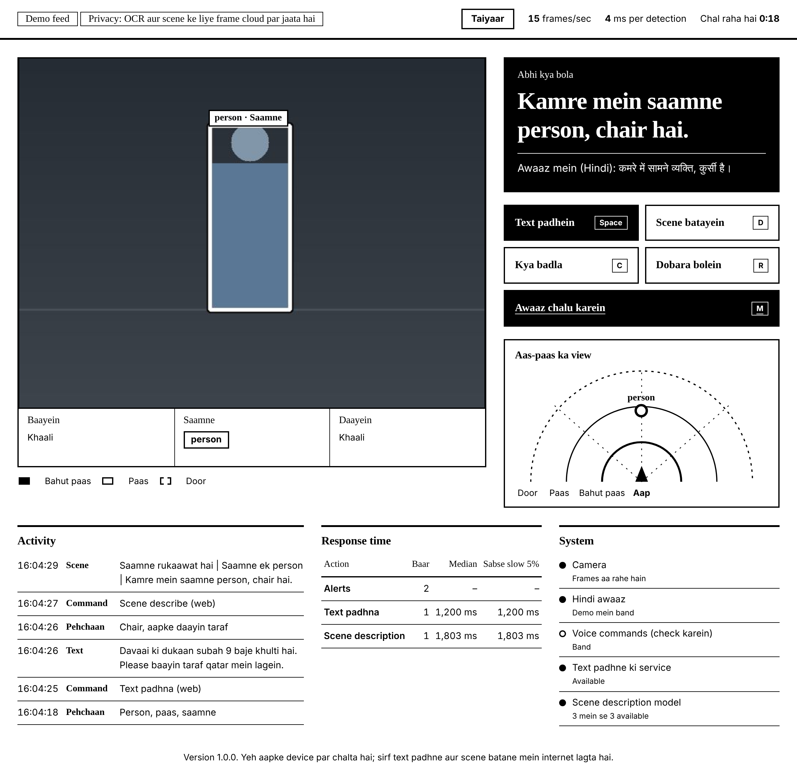
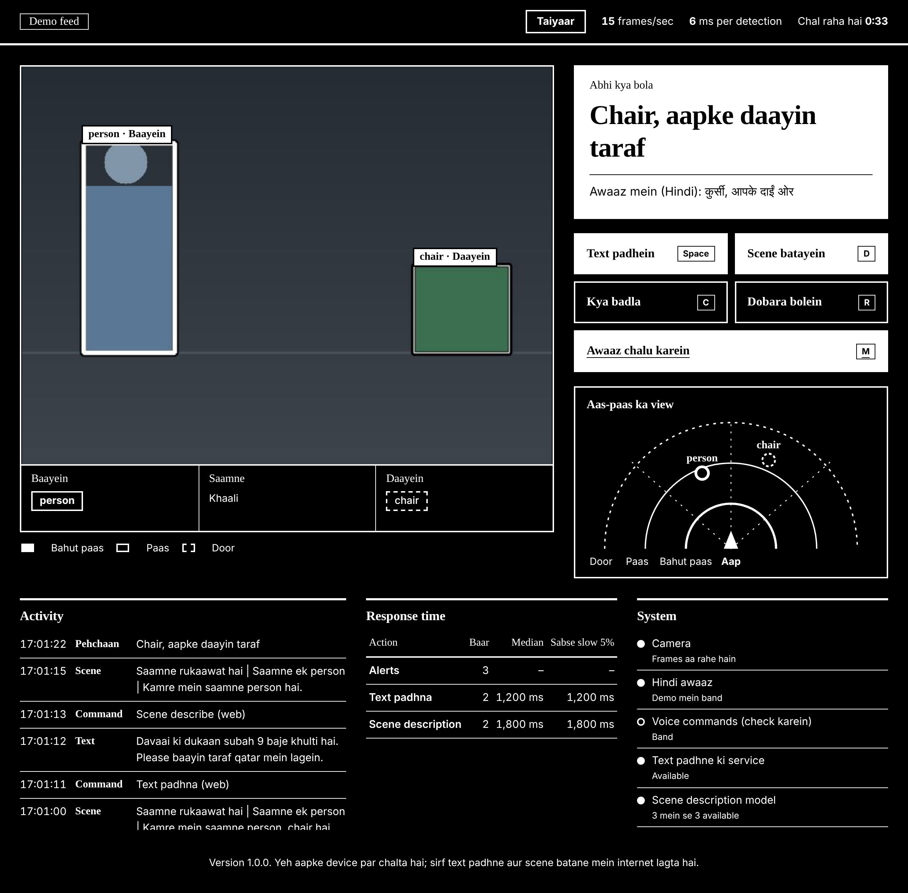
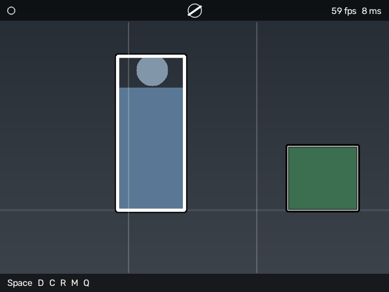

<div align="center">

# VisionAssist

### Offline-first Hindi AI vision assistant for blind and visually impaired people

**हिंदी में बोलने वाला, इंटरनेट के बिना भी काम करने वाला विज़न असिस्टेंट**

A webcam watches the scene. VisionAssist speaks short, prioritised alerts in Hindi (*"व्यक्ति, बहुत पास, सामने"*), reads printed text aloud, and describes the whole scene on request. Safety alerts never need the internet.

[](https://github.com/techakash32/Hindi-multimodal-vision-assistant/actions/workflows/ci.yml)
[](LICENSE)


-orange)
[](https://github.com/techakash32/Hindi-multimodal-vision-assistant/stargazers)

[**Try the demo in 60 seconds**](#try-it-in-60-seconds-no-camera-no-keys) ·
[**Quick start**](#quick-start) ·
[**FAQ**](#frequently-asked-questions) ·
[**Contribute**](#contributing)



<sub>The dashboard in <code>--demo</code> mode (synthetic camera feed). With a real camera it shows your video and real results.</sub>

</div>

---

## What is VisionAssist?

**VisionAssist is an open-source, offline-first assistive vision system that speaks Hindi.** It runs on an ordinary laptop with a webcam. It detects nearby objects with YOLOv8, says what they are, how close they are and which side they are on, reads signs and medicine labels with OCR, and describes scenes with a vision-language model. Hindi speech comes from an offline Piper voice, and hands-free commands come from an offline Vosk Hindi model.

It is built for the many Hindi speakers who get no assistive technology in their own language, since most tools assume English and a constant internet connection.

> **Important:** VisionAssist is an assistive aid, not a safety device. It does not replace a cane, a guide dog or sighted help. See [Known limitations](#known-limitations).

## Why it is different

| | Typical vision apps | **VisionAssist** |
| --- | --- | --- |
| Language | English first, Hindi as an afterthought | **Hindi only for everything the user hears or reads** |
| Internet | Required for almost everything | **Object alerts, voice commands and "what changed" work offline** |
| Alerts | Constant chatter | **Each object is announced once until it leaves view** |
| Failure | Hangs or goes silent | **Spoken Hindi fallback, circuit breakers, detection keeps running** |
| Honesty | Confident guesses | **Abstains and asks for clarification instead of guessing** |
| Privacy | Frames go to the cloud | **`LOCAL_ONLY=true` keeps every frame on the device** |
| Cost | Subscription or paid API | **Free and MIT licensed; free-tier APIs are optional** |

## Features

| Need | How | Works offline |
| --- | --- | --- |
| Know what is nearby | YOLOv8n detects objects every other frame; alerts say *what*, *how close* and *which side* | Yes |
| Not be nagged | Alerts need a stable, confident, large-enough detection, and each object is announced once until it leaves view | Yes |
| Hear everything in Hindi | Offline Hindi Piper voice; every spoken and on-screen message is Hindi, and text from signs is translated to Hindi | Yes (translating English signs needs internet) |
| Read a label or sign | OCR on the centre of the frame (**Space**), with a local Tesseract fallback | Local OCR: yes |
| Understand the scene | Free OpenRouter vision models with JSON output, hedged requests and circuit breakers (**D**) | No |
| Know what changed | Compares objects now versus the last description (**C**) | Yes |
| Hear it again | **R** repeats the last message | Yes |
| Hands-free | Offline Hindi voice commands: "Text padhein", "Scene batayein", "Kya badla", "Dobara bolein", "Awaaz band karein" | Yes |
| Use it your way | OpenCV window, Hindi web dashboard, or headless voice-only mode for a wearable or Raspberry Pi | Yes |

## Try it in 60 seconds (no camera, no keys)

You need Python 3.10 to 3.12 and nothing else.

```bash
git clone https://github.com/techakash32/Hindi-multimodal-vision-assistant.git
cd Hindi-multimodal-vision-assistant
python -m venv venv && source venv/bin/activate     # Windows: venv\Scripts\activate
pip install -r requirements.txt && pip install -e .
visionassist run --ui web --demo                    # open http://127.0.0.1:8000
```

The demo uses a synthetic camera feed and canned OCR and scene text, so you can see the full Hindi dashboard without hardware, models or API keys.

## Quick start

Step-by-step setup for Windows, macOS and Linux, including Docker and real-hardware benchmarking: [docs/SETUP_LOCAL.md](docs/SETUP_LOCAL.md).

```bash
# 1. Get the code and create an environment (Python 3.10 to 3.12)
git clone https://github.com/techakash32/Hindi-multimodal-vision-assistant.git
cd Hindi-multimodal-vision-assistant
python -m venv venv
source venv/bin/activate          # Windows: venv\Scripts\activate

# 2. Install
pip install -r requirements.txt
pip install -e .                  # adds the `visionassist` command

# 3. Download the models (YOLO ~6 MB, Hindi voice ~60 MB, Hindi Vosk model ~40 MB)
visionassist download-models

# 4. Add your free API keys (only needed for Read text and Describe scene)
cp .env.example .env              # Windows: copy .env.example .env
#    then edit .env: OCR_API_KEY=...  OPENROUTER_API_KEY=...

# 5. Check everything is in place, then run
visionassist check
visionassist run                  # opens the Hindi dashboard in your browser
```

## Controls

| Key / voice | Action |
| --- | --- |
| **Space** / "टेक्स्ट पढ़ें" (Text padhein) | Read text in front of the camera |
| **D** / "सीन बताएं" (Scene batayein) | Describe the scene (skipped if nothing changed in 30 s) |
| **C** / "क्या बदला" (Kya badla) | What changed since the last description (offline, instant) |
| **R** / "दोबारा बोलें" (Dobara bolein) | Say the last message again |
| **M** | Mute or unmute sound (text still appears on screen) |
| **Q**, **Esc** / "आवाज़ बंद करें" (Awaaz band karein) | Quit. By voice the whole phrase is needed; "band" alone does nothing. The dashboard button of that name only mutes. |

Click the OpenCV window once so it receives keystrokes.

## How it works

```
                 ┌──────────────── Assistant engine (engine.py) ────────────────┐
 Camera ───────► │ capture loop ─► YOLOv8n ─► stability filter ─► alert ─► TTS  │ ─► Piper (offline)
 (or demo feed)  │      │                                                        │
                 │      └─► latest frame ──► worker thread ─► OCR / VLM ─► TTS   │ ─► OpenRouter, OCR.space
                 └───────┬──────────────────────────────┬────────────────────────┘
                         │ snapshot() / jpeg()          │ dispatch(cmd)
              ┌──────────▼───────────┐       ┌──────────▼───────────┐
              │ OpenCV window + HUD  │       │ Flask web dashboard  │   keyboard · voice · buttons
              └──────────────────────┘       └──────────────────────┘
```

Design decisions worth knowing:

- **Fast loop and reasoning tier are separate.** Detection and speech run locally. Network calls run on one worker thread, so a slow API never freezes the camera.
- **Graceful degradation.** Every failure produces a spoken fallback and detection continues. Failing providers are benched by circuit breakers.
- **Latency hedging.** If the preferred vision model has not answered after 5 s, the next one is also asked and the first answer wins.
- **Abstain before guessing.** When input quality is low, the VLM is not called. The assistant asks a clarification question instead of hallucinating.
- **Honest about safety.** The scene prompt forbids "safe to pass" claims; "path clear" is never announced unless you opt in.
- **Newest alert wins.** If speech backs up, the *oldest* queued utterance is dropped, not the newest.
- **One engine, many frontends.** The engine has no UI code, so the window, the dashboard and the tests all drive it the same way.

Architecture decision records: [docs/adr/](docs/adr/README.md).

## Tech stack

| Layer | Technology |
| --- | --- |
| Object detection | [YOLOv8n](https://github.com/ultralytics/ultralytics) (Ultralytics), COCO classes |
| Hindi text-to-speech | [Piper](https://github.com/rhasspy/piper), offline Hindi voice |
| Hindi speech recognition | [Vosk](https://alphacephei.com/vosk/) Hindi model, restricted command list |
| OCR | OCR.space API with local Tesseract fallback |
| Scene description | Free vision-language models through OpenRouter |
| Translation | `deep-translator` into Hindi |
| UI | Flask dashboard (plain HTML/CSS/JS, no CDN), OpenCV window |
| Tooling | Python 3.10 to 3.12, pytest, ruff, Docker, GitHub Actions |

## Commands

| Command | Purpose |
| --- | --- |
| `visionassist run` | Camera + Hindi browser dashboard at `http://127.0.0.1:8000` (opens automatically) |
| `visionassist run --no-browser` | Same, without opening a browser tab |
| `visionassist run --ui window` | OpenCV window (boxes only; OpenCV cannot draw Hindi text) |
| `visionassist run --ui both` | Window and dashboard together |
| `visionassist run --ui headless` | No UI; voice and speech only (for a wearable or Raspberry Pi) |
| `visionassist run --demo` | Synthetic camera and detector; no hardware, models or keys |
| `visionassist run --camera 1` | Use a different camera |
| `visionassist run --mute` | Show speech on screen without playing audio |
| `visionassist run --no-voice` | Disable microphone commands |
| `visionassist run --port 9000 --host 0.0.0.0` | Dashboard on another port or the network (set `WEB_TOKEN` first) |
| `visionassist run --record` | Record a session for later replay |
| `visionassist replay logs/sessions/<time>` | Re-run every recorded request and list what changed |
| `visionassist check` | Verify models, voices and keys; exit code 1 if the safety loop cannot run |
| `visionassist download-models [--only yolo,hi,vosk-hi,en,vosk] [--force]` | Fetch models (default: yolo, hi, vosk-hi) |
| `visionassist mics` | List microphones and the order they will be tried |
| `make test` / `make lint` | Run tests with coverage / lint |
| `python tools/latency_benchmark.py --vlm 3 --ocr 3` | Measure FPS and latency on your hardware |

## Hindi-only mode

Everything the user hears or reads is Hindi: spoken alerts, status messages, scene descriptions (the vision model is asked to answer in Hindi; English answers are translated), text read from signs, the dashboard labels, the activity feed and voice commands. All user-facing text lives in [`strings.py`](src/visionassist/strings.py). English remains only in logs, CLI help and docs.

- If the Hindi voice is missing the assistant stays silent and reports the problem instead of speaking English; `visionassist check` fails until you run `visionassist download-models --only hi`.
- If a translation fails the user hears a Hindi "translation unavailable" message, never English.
- OpenCV cannot draw Devanagari, so object names are shown by the dashboard; the optional window shows boxes only.
- Voice commands use the small Vosk Hindi model with a restricted word list (with spelling variants). Recognition quality depends on your microphone and accent, so tune `COMMANDS` in [`voice.py`](src/visionassist/voice.py) after trying it.
- Set `HINDI_ONLY=false` to bring back the English voice path (it is not the default).

## Web dashboard

Live annotated video, a left/ahead/right strip showing where each object is (solid chip = very close, outlined = nearby, dashed = far), the last spoken message in large type, command buttons, activity feed, response-time table and a system panel. Hindi labels, strictly black and white, built with plain HTML/CSS/JS and system fonts, so it works with no internet. Light and dark themes follow your system, controls have keyboard shortcuts and focus outlines, and the speech card is an `aria-live` region.

<p align="center">
  
  
</p>

**Security:** it binds to `127.0.0.1` by default, sends a strict Content-Security-Policy, accepts commands only as JSON, and refuses remote `quit`. If you expose it on a network, set `WEB_TOKEN` in `.env`; it is accepted once as `?token=...` and then kept in an HttpOnly cookie. The camera feed is sensitive, so do not expose it without a token.

## Privacy

Set `LOCAL_ONLY=true` and no frame or text leaves the device: OCR runs on local Tesseract, cloud scene description and translation are switched off, and the dashboard says so. In the default mode, OCR.space and OpenRouter receive camera frames when you ask to read text or describe a scene; the dashboard says so.

## Configuration

Everything is configurable through `.env` or environment variables; see [`.env.example`](.env.example) and [`src/visionassist/config.py`](src/visionassist/config.py). Common ones:

| Variable | What it does |
| --- | --- |
| `CAMERA_INDEX` | Which camera to use |
| `YOLO_IMGSZ` | `320` fast, `640` accurate |
| `VLM_MODELS` | Free models come and go; override the list without code changes |
| `VOSK_MODEL` | An Indian-English model recognises Indian accents much better |
| `VOICE_MIC_NAMES` | Preferred microphones, in order |
| `LOCAL_ONLY` | Keep every frame on the device |
| `WEB_TOKEN` | Required if you expose the dashboard on a network |
| `HINDI_ONLY` | Set to `false` to allow the English voice path |

Files are looked up under `VISIONASSIST_HOME` (default: the folder you run from): `models/`, `voices/`, `logs/`.

## Evaluation

`eval/scenarios.jsonl` holds 80 scenarios (OCR medicine 12, OCR sign 12, OCR menu 8, scene description 20, ambiguous question 10, negative/abstain 10, voice command 8). Fixtures in `eval/fixtures/` are **synthetic** (rendered text and coloured blocks), see `eval/fixtures/README.md`. `eval/run_eval.py` runs each scenario through `visionassist.pipeline.run_once`, the same entry point the app uses, scores each modality, and assigns every failure exactly one bucket.

Latest run (sandbox: Tesseract OCR, demo colour-blob detector, template stand-in for the VLM, typed transcripts; full report in [`reports/eval_report.md`](reports/eval_report.md)):

| Modality | n | Precision | Recall | F1 | Notes |
|---|---|---|---|---|---|
| OCR: medicine labels | 12 | 0.80 | 0.80 | 0.80 | CER 0.15, WER 0.24 |
| OCR: signs | 12 | 1.00 | 0.92 | 0.96 | CER 0.08, WER 0.08 |
| OCR: menus | 8 | 0.71 | 0.83 | 0.77 | CER 0.09, WER 0.17 |
| OCR: all | 32 | 0.86 | 0.86 | 0.86 | exact match 0.75 |
| Scene description (VLM) | 20 | 0.81 | 1.00 | 0.90 | 13/20 correct, 4 partial |
| Voice command (intent) | 8 | 1.00 | 0.75 | 0.86 | 6/8 correct, 2 abstained |

**Abstention accuracy: 10/10** on the negative scenarios (5/5 on the holdout half never used for tuning). On a 20-case adversarial pack (blur, low light, noise, occlusion) the guardrails behaved as intended in 19 cases and abstained on all 10 severe ones; with guardrails off the same set produced 7 failures.

> **Read this before quoting any number.** These results use synthetic images and small n (8 to 20 per row). No live camera, real Hindi speech, real Piper audio or live VLM was used. They show the pipeline and guardrails work as designed, **not real-world accuracy**. Details in [`reports/eval_report.md`](reports/eval_report.md).

Reproduce everything without a camera, models or keys:

```bash
pip install -r requirements-dev.txt
python -m eval.run_eval --scenarios eval/scenarios.jsonl --out reports/eval_raw.json
python -m eval.calibrate_abstention
python tools/latency_benchmark.py
```

## Graceful degradation

| What fails | What the user gets |
| --- | --- |
| Camera lost mid-session | Spoken "camera kaam nahi kar raha", automatic reconnect, spoken confirmation when frames return |
| OCR call fails or times out | Spoken OCR error; after 3 failures OCR pauses for 60 s instead of hanging every request |
| Scene description fails | Spoken scene error; several models are raced and each has its own breaker |
| Translation fails | Original text is shown; speech falls back to the Devanagari tables |
| Low confidence input | The VLM is not called; a clarification question is spoken and shown |
| Speech queue backs up | Oldest alert is dropped, newest kept |
| Hindi voice missing | `visionassist check` fails; nothing is spoken in English, text stays on screen |
| Vosk model or microphone missing | Voice commands off; keys and dashboard buttons keep working |
| Dashboard connection lost | Offline banner (screen-reader alert) and automatic retry |

These are covered by unit tests with fakes; none was tested against a real unplugged camera or a dead network.

## Accessibility

Skip link, `aria-live` region for the last spoken sentence, `role="alert"` for connection loss, `<noscript>` fallback, visible focus, keyboard shortcuts, and pure black-on-white contrast (21:1, checked by a test). **Not yet tested with a real screen reader (NVDA / VoiceOver).** For a blind user the `--ui headless` voice mode is the primary interface.

## Project layout

```
src/visionassist/
  engine.py        camera loop, commands, OCR/VLM workers (no UI code)
  detector.py      YOLO + temporal smoothing and announce rules
  scene.py         "same scene?" logic (pure functions)
  vlm.py ocr.py    network tiers with circuit breakers and hedging
  tts.py voice.py  Piper speech out, Vosk commands in
  ui_cv.py draw.py OpenCV window and HUD
  web/             Flask dashboard (templates, static)
  strings.py       every user-facing string (Devanagari voice, Hinglish screen)
  pipeline.py      run_once(): the single entry point used by the app and by eval
  guardrails.py    should_abstain(): refuse before the VLM when unsure
  hinglish.py      Devanagari to Roman screen text
  recorder.py      session recording and replay
  cli.py           `visionassist` command
tests/             unit tests, all run without a camera, models or network
eval/              80-scenario benchmark, runner, failure classifier, calibration
config/            abstention.json (calibrated thresholds)
reports/           eval and latency reports
tools/             manual hardware checks and latency benchmark
```

## Troubleshooting

| Symptom | Fix |
| --- | --- |
| `Cannot open camera` | Try `--camera 1`; close Teams, Zoom or other apps using the camera |
| Window ignores keys | Click the window first |
| `[FAIL] YOLO model` / voice missing | `visionassist download-models` |
| No sound at all | `visionassist download-models --only hi`, then `visionassist check` |
| No sound on Linux | Install `alsa-utils` (`aplay`), `pulseaudio-utils` or `ffmpeg` |
| Voice commands never trigger | `visionassist mics`; set `VOICE_MIC_NAMES` or `VOICE_MIC_DEVICE`; try an Indian-English Vosk model |
| Piper fails to load a voice | Re-download with `--force`; check `piper-tts` version |
| "Scene description unavailable" | Add `OPENROUTER_API_KEY`; free models may be rate limited, wait a minute |

## Known limitations

- This is an **assistive aid, not a safety device**. It can miss or misjudge objects, and free vision models can be wrong. Do not rely on it in place of a cane, guide dog or sighted help.
- Detection uses COCO classes; steps, kerbs, holes and glass doors are not detected.
- "Near / nearby / far" is estimated from box size, not measured depth.
- Evaluation uses synthetic images only (see [Evaluation](#evaluation)).
- Hindi voice-command accuracy has not been measured on real speech. Scene and text results come from free online services with rate limits.

## Frequently asked questions

### What is VisionAssist?
VisionAssist is a free, open-source, Hindi-speaking assistive vision system for blind and visually impaired users. It uses a webcam, YOLOv8 object detection, OCR and a vision-language model, and speaks in Hindi using an offline voice.

### Does VisionAssist work without internet?
Yes, for the safety-critical parts. Object detection, Hindi speech output, Hindi voice commands and "what changed" all run locally. Reading text (OCR.space) and scene descriptions (OpenRouter) use the internet by default. With `LOCAL_ONLY=true`, OCR uses local Tesseract and cloud features are switched off.

### Which languages does it support?
Hindi is the default and only user-facing language. Everything spoken or shown is Hindi. Screen text can also appear in Hinglish (Hindi written in Roman letters). An English voice path exists behind `HINDI_ONLY=false`.

### Can it read medicine labels, signs and menus?
Yes. Press **Space** or say "text padhein". The centre of the frame goes through OCR and the result is read aloud in Hindi, translated if the text is English. Accuracy on real-world labels has not been measured; see [Evaluation](#evaluation).

### Is it safe to use for navigation?
No. It is an assistive aid and not a safety device. It cannot detect steps, kerbs, holes or glass doors, and distance is estimated from box size. Keep using your cane, guide dog or sighted help.

### What hardware do I need?
A laptop with a webcam is enough to start, with no GPU required. Run `python tools/latency_benchmark.py` to measure speed on your machine. The `--ui headless` mode is designed for wearables and Raspberry Pi style devices, though it has not been benchmarked on those here.

### Does it send my camera feed to the cloud?
Only when you ask it to read text or describe a scene in the default mode, and then only that frame goes to OCR.space or OpenRouter. With `LOCAL_ONLY=true` nothing leaves the device.

### Is it free?
Yes. The code is MIT licensed. The optional OCR.space and OpenRouter services have free tiers with rate limits.

### How is this different from Be My Eyes, Seeing AI or Lookout?
Those are polished consumer apps that depend on cloud services and mainly serve English. VisionAssist is an open, hackable, Hindi-first, offline-first project you can inspect, run yourself and extend. It is a research and engineering project and is not a product replacement for them.

### Can I add another Indian language?
It is designed to make that easier: all user-facing text is in [`strings.py`](src/visionassist/strings.py), and Piper and Vosk both have models for other languages. It is a good first contribution. See [Contributing](#contributing).

## Contributing

Contributions are very welcome, especially from blind and low-vision users, Hindi speakers and accessibility practitioners. High-value areas:

- Test with a real screen reader (NVDA, VoiceOver, TalkBack) and report what breaks
- Real-world Hindi voice-command and OCR test clips
- Other Indian languages (Marathi, Bengali, Tamil, Telugu and more)
- Raspberry Pi and wearable benchmarks
- Step, kerb and glass-door detection

See [CONTRIBUTING.md](CONTRIBUTING.md). Run `make test` and `make lint` before opening a pull request.

## Citation

If you use VisionAssist in research or a project, please cite it. GitHub's "Cite this repository" button uses [`CITATION.cff`](CITATION.cff).

## License

MIT. See [LICENSE](LICENSE).

---

<div align="center">

**If this project could help someone you know, a ⭐ helps more people find it.**

Built with [Ultralytics YOLOv8](https://github.com/ultralytics/ultralytics), [Piper](https://github.com/rhasspy/piper), [Vosk](https://alphacephei.com/vosk/), [OpenCV](https://opencv.org/) and [Flask](https://flask.palletsprojects.com/).

<sub>Keywords: Hindi assistive technology, AI for the blind, visually impaired assistant, offline Hindi text to speech, Hindi OCR, YOLOv8 object detection, Hindi voice commands, accessibility, computer vision for India, multimodal vision assistant, edge AI.</sub>

</div>
